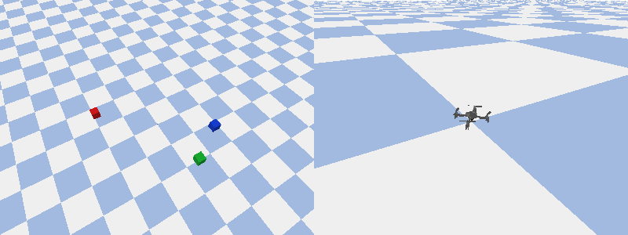
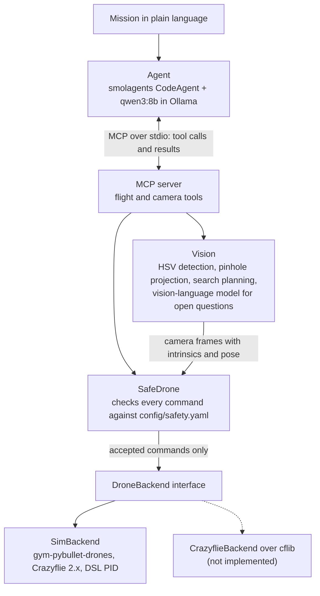

# SkyPilot Agent

[](https://github.com/antoinehinary/skypilot-agent/actions/workflows/ci.yml)

An AI agent that flies a simulated Crazyflie drone from plain-language missions. It plans,
calls drone tools over [MCP](https://modelcontextprotocol.io), finds objects with an onboard
camera, and every command passes a safety layer that can refuse it with a reason. Everything runs
locally: the LLM in [Ollama](https://ollama.com), the physics in PyBullet.



*`"find the red box and land on it"`, flown by `qwen3:8b` running locally. The box starts out of
the camera's view: the agent flies to the first suggested search position, finds the box, flies
above it, looks again to refine, and lands on top (7 steps, 29 s). Left: overview with the flight
trail. Right: chase camera.*

- **The agent never touches the simulator.** It only sees MCP tools; the same server works with
  any MCP client, and the drone sits behind an interface a real Crazyflie backend could implement.
- **Every command is checked by a safety layer** (geofence, altitude, speed, battery, mission
  time). Refusals say why and give the nearest allowed command; landing is never refused.
- **Vision with calibrated geometry:** colour detection in HSV, then the pixel's viewing ray is
  intersected with the ground using the camera's intrinsics and pose.
- **Evaluated, not just demoed:** 10 missions scored on the drone's actual final state. Changing
  what the tools say back took the local `qwen3:8b` from 5/10 to 8/10
  ([results](#evaluation)).

## Quickstart

Requirements: macOS or Linux, [conda](https://github.com/conda-forge/miniforge), git and
[Ollama](https://ollama.com) running. Everything else is installed inside the repository folder.

```bash
git clone https://github.com/antoinehinary/skypilot-agent.git && cd skypilot-agent
conda create -p ./.venv python=3.12 -y && conda activate ./.venv
git clone https://github.com/learnsyslab/gym-pybullet-drones.git external/gym-pybullet-drones && git -C external/gym-pybullet-drones checkout 15c426c
CFLAGS="-Dfdopen=fdopen" pip install -e ".[sim,agent,dev]" && pip install -e external/gym-pybullet-drones --no-deps
ollama pull qwen3:8b && python -m skypilot.agent.run_agent "take off to 1 m, fly to (2, 2, 1), land" --gui
```

The `CFLAGS` flag lets `pybullet` build from source on macOS (it takes a few minutes; Linux needs
no flag). The simulator is installed with `--no-deps` to skip its reinforcement-learning
dependencies (torch, stable-baselines3), which this project does not use: pip warns about them,
which is expected. For `describe_scene`, also run `ollama pull qwen2.5vl:7b`.

More missions:

```bash
python -m skypilot.agent.run_agent "find the red box and hover above it" --gui
python -m skypilot.agent.run_agent "take off to 1 m, then fly up to 50 m"     # refused by the safety layer
python -m skypilot.agent.run_agent "find the red box and land on it" \
    --world missions/worlds/moved.yaml --record media/run.gif                 # search, and save a GIF
```

Use `python -m pytest` rather than a bare `pytest`, so the tools run from the project
environment even if another Python comes first on your `PATH`.

## Architecture



Each layer only talks to the one below it:

- **Agent.** At each step the model writes a short Python snippet calling the tools, reads the
  result (`OK: reached (2.00, 2.00, 1.00) in 5.7 s. Now flying at ...`) and decides the next step.
  It runs in smolagents' restricted interpreter, where the tools are the only way to act.
- **MCP server.** Exposes the drone as typed tools with units in their names (`goto(x_m, y_m,
  z_m)`). Results are short factual strings that end with the next call to make, which small
  models follow far more reliably than open advice.
- **SafeDrone.** A `DroneBackend` wrapping the real one: refused commands never reach the drone.
  The server always goes through it; there is no bypass flag.
- **DroneBackend.** Blocking `takeoff / goto / move_relative / hover / land`, `get_state`, and
  `get_camera_image` returning the image with its calibration. `SimBackend` ramps a straight-line
  setpoint at the requested speed with velocity feed-forward into the Crazyflie PID controller.

Conventions: SI units (metres, seconds, m/s); world frame **x forward, y left, z up**, origin at
the take-off pad.

## How it works

### Drone tools over MCP

| Tool | Result |
| --- | --- |
| `takeoff(altitude_m)`, `goto(x_m, y_m, z_m)`, `move_relative(dx_m, dy_m, dz_m)`, `hover(seconds)`, `land()` | `OK`, `FAILED` or `REFUSED`, what happened, the new position and battery |
| `get_state()` | position, velocity, battery, flying or landed |
| `find_objects(colour)` | world (x, y) and size of each object of that colour in view, with the step that flies above it; if nothing is found, the next search positions |
| `get_camera_image()` | path of a saved PNG and the ground area it covers |
| `describe_scene(question)` | answer from a vision-language model (qualitative questions only) |

The server works with any MCP client, e.g. the
[MCP Inspector](https://github.com/modelcontextprotocol/inspector):

```bash
npx @modelcontextprotocol/inspector ./.venv/bin/python -m skypilot.mcp_server.server --gui
```

### Vision

The drone carries a downward-facing camera on a yaw-only gimbal (320x240, 60° field of view).
Each frame comes with its pinhole intrinsics `K` and camera-to-world pose, the data a calibrated
real camera and a state estimator would provide, so the localisation code would not change on
hardware. `find_objects` thresholds the image in HSV (a saturation floor separates the boxes from
the pale checkered floor), takes each blob's centroid and intersects its viewing ray with the
ground. The box tops sit above that plane, so an estimate is off by ~0.1 m when seen from 1 m to
the side and by <1 cm from directly above: the tool tells the agent to fly above and look again.
When nothing is in view, a planner tiles the geofence with camera footprints and suggests the
nearest areas not yet seen, until the whole area has been covered.

### Safety layer

| Rule | Default ([`config/safety.yaml`](config/safety.yaml)) |
| --- | --- |
| Geofence | x, y in [-3, 3] m |
| Flight altitude | z in [0.2, 3.0] m |
| Speed | at most 1.0 m/s |
| Battery | 30 % to take off; below 20 %, only landing |
| Mission time | 300 s of sim time; after that, only landing |
| Landing | always allowed |

The rules are pure functions of (state, request, limits), so every limit and boundary is unit
tested without a simulator. A refusal gives the reason and the nearest allowed command:

```
REFUSED: target z=50.01 m exceeds the 3.00 m altitude limit; choose z between 0.20 and 3.00 m;
nearest allowed: goto(x_m=0.00, y_m=0.01, z_m=3.00). Now flying at (0.00, 0.01, 1.01) m, ...
```

Every decision, accepted or refused, is appended with a timestamp to `runs/safety_log.jsonl`.

### Configuration

| What | Where |
| --- | --- |
| Model, context size, reply cap, timeouts, step budget | [`config/agent.yaml`](config/agent.yaml) |
| Another model (any [LiteLLM](https://docs.litellm.ai/docs/providers) id) | `--model <id>` or `MODEL_ID` in the environment / `.env` (see `.env.example`) |
| Control rates, motion, battery model, camera | [`config/sim.yaml`](config/sim.yaml) |
| Objects in the scene | [`config/world.yaml`](config/world.yaml) |
| Colour thresholds, vision model | [`config/vision.yaml`](config/vision.yaml) |
| Safety limits | [`config/safety.yaml`](config/safety.yaml) |

## Evaluation

[`missions/`](missions/) holds the mission suite: a plain-language task, an optional setup (scene,
starting battery), ground-truth checks and a reference solution. The runner flies every mission
headless and scores it on what actually happened (the drone state read after the run and the
safety decisions logged during it), never on the agent's own report. Each reference solution is
replayed through the real agent, MCP server and simulator in the test suite, so every mission is
known to be achievable and every check to accept a correct run.

```bash
python -m skypilot.eval.run_eval --label qwen3:8b             # one configuration
python -m skypilot.eval.run_eval --think --label qwen3:8b+think
python -m skypilot.eval.run_eval --reference                  # replay the reference solutions
python -m skypilot.eval.report --update-readme                # regenerate the table below
```

<!-- results:start -->
| Configuration | Success | Basic | Vision | Safety | Steps / mission | Tokens / mission | Time / mission | Retried refusals | Reports with correct position |
| --- | --- | --- | --- | --- | --- | --- | --- | --- | --- |
| `qwen3:8b` | **8/10** | 2/3 | 3/4 | 3/3 | 5.9 | 25.5k | 20 s | 0 | 10/10 |
| `qwen3:8b+plan` | **8/10** | 3/3 | 2/4 | 3/3 | 7.6 | 47.7k | 84 s | 1 | 8/8 |
| `qwen2.5vl:7b` | **2/10** | 1/3 | 0/4 | 1/3 | 9.9 | 57.1k | 65 s | 0 | 4/6 |
| `qwen3:8b+think` | **8/10** | 3/3 | 2/4 | 3/3 | 6.8 | 32.3k | 160 s | 0 | 9/9 |

<details><summary>Per-mission results</summary>

| Mission | `qwen3:8b` | `qwen3:8b+plan` | `qwen2.5vl:7b` | `qwen3:8b+think` |
| --- | --- | --- | --- | --- |
| goto_point | pass | pass | fail (unfinished) | pass |
| square | fail (visited) | pass | fail (unfinished) | pass |
| takeoff_hover_land | pass | pass | pass | pass |
| altitude_limit | pass | pass | pass | pass |
| geofence | pass | pass | fail (unfinished) | pass |
| low_battery | pass | pass | fail (unfinished) | pass |
| find_red_hover | pass | pass | fail (final_position;unfinished) | pass |
| find_red_moved | pass | pass | fail (final_position;unfinished) | fail (landed) |
| land_on_green | fail (unfinished) | fail (final_position) | fail (final_position) | fail (landed;final_position;unfinished) |
| missing_yellow | pass | fail (landed;unfinished) | fail (landed;unfinished) | pass |

</details>

10 missions, one run per configuration at temperature 0 with a fixed seed: repeatable within a session, but a rerun on another day can differ on some missions, so treat single-mission differences between configurations as indicative, not significant. Runs were headless on an Apple Silicon MacBook Pro, all models local in Ollama. Success is scored on the drone's verified final state and the safety log, never on the agent's report; a report's position counts as correct within 0.15 m.
<!-- results:end -->

A mission only counts as a success if every check passes **and** the agent finished with a
report within its step budget: an agent that triggers the right refusal and then loops until it
runs out of steps has not completed the mission.

**Effect of tool feedback.** The first evaluation showed vision missions failing on tool misuse,
not on detection. Tool results were then changed to end with the next call to make, as safety
refusals already did: `find_objects` suggests the step that flies above a detection and, when
nothing is found, the next search views (planned at the altitude ceiling as a minimal tiling of
the geofence); `takeoff` while flying suggests the `goto` that changes altitude. A second round
made each search step one code block (`goto(...); find_objects(...)`) and capped replies at 2048
tokens. Same 10 missions at each stage:

| Configuration | First evaluation | Tool hints | + search tiling, reply cap |
| --- | --- | --- | --- |
| `qwen3:8b` | 5/10 | 7/10 | **8/10** |
| `qwen3:8b+plan` | 7/10 | 6/10 | **8/10** |
| `qwen2.5vl:7b` | 4/10 | 4/10 | 2/10 |
| `qwen3:8b+think` | 7/10 | 7/10 | **8/10** |

**What the failures show** (from the transcripts in `results/*/logs/`):

- **Safety held in every run.** Whenever an agent sent an out-of-limit command it was refused
  before reaching the drone; with the current tools every qwen3 configuration passes all three
  safety missions.
- **Tool feedback matters more than model settings.** With the hints, the plain `qwen3:8b`
  matches the forced-plan and thinking configurations (8/10 each) at 20 s per mission instead of
  84 s and 160 s. `find_red_moved`, which no configuration solved at first, now passes for the
  base and forced-plan configurations.
- **The reply cap removed the timeouts.** The same four missions had timed out at 120 s per call
  (forced plan, thinking) in two separate runs; with replies capped at 2048 tokens none did.
- **The remaining vision failure is the step budget.** In `land_on_green` the base model searched,
  found and landed on top of the box at (2.00, 1.48, 0.31) on its 12th and last step, with no step
  left to report, so it counts as unfinished: it still split each search step in two. The
  forced-plan run gave up after two empty views and landed beside the pad.
- **`qwen2.5vl:7b` is not a usable code agent here:** it prints status text it invented
  ("Takeoff successful") instead of tool results and often answers without a code block.
- **The evaluation also caught bugs in the system and the harness:** relative moves offset from
  the drifting measured position instead of the setpoint (a climb to the 3.00 m limit targeted
  3.01 m and was refused), and the first search planner reported "the whole search area has been
  covered" while the geofence corners were unseen. Both fixed with regression tests before the
  numbers above.

With one run per configuration, differences of one or two missions are indicative only.

## Development

```bash
python -m pytest                     # everything; simulator headless, LLMs replaced by scripted models
python -m pytest -m "not sim"        # pure-Python tests only, no PyBullet needed (what CI runs first)
python -m ruff check . && python -m ruff format --check .
python scripts/square_flight.py --gui  # scripted 1 m square, no LLM; saves media/square.gif
```

CI (GitHub Actions) runs lint and the pure-Python tests, then the simulator tests headless with
scripted models, including every mission's reference solution. No LLM is needed in CI.

```
config/          YAML: agent, simulator, world, vision, safety
missions/        evaluation missions (YAML) and alternative worlds
scripts/         scripted square flight
src/skypilot/
  agent/         CLI, prompt, smolagents CodeAgent over MCP
  drone/         DroneBackend interface, PyBullet SimBackend, scene and recording helpers
  eval/          missions, ground-truth checks, batch runner, README tables
  mcp_server/    FastMCP server: flight and camera tools
  safety/        pure rules and the SafeDrone guard
  vision/        camera geometry, colour detection, search planning, scene description
tests/           unit tests and headless simulator tests
```

## Known limitations and next steps

- **Simulation only.** The `DroneBackend` interface and calibrated `CameraFrame` are designed so a
  Crazyflie backend over `cflib` (with the AI-deck camera) could replace the simulator; it is not
  implemented.
- **Small evaluation.** 10 missions with one run per configuration; differences of one or two
  missions are not significant. Next: grow the suite and run repeats.
- **Step budget on searches.** Searching the whole area costs most of the 12-step budget when
  the model splits each search step in two.
- **Text tool results.** Tools return strings; `qwen2.5vl:7b` tried to index them like
  dictionaries. Structured (JSON) results are a possible next step.
- **Partly visible objects.** A box cut by the image border is localised from its visible part
  only, which biases its position and size until the agent flies above it.
- **Seeded but not fully reproducible.** Temperature 0 and a fixed seed make runs repeatable
  within a session; across sessions some missions can differ.

## License

MIT
