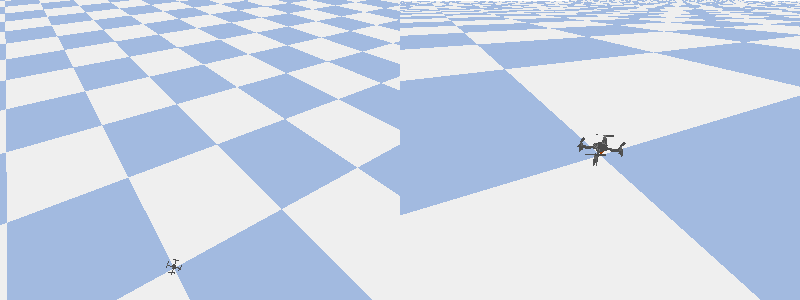

# SkyPilot Agent

[](https://github.com/antoinehinary/skypilot-agent/actions/workflows/ci.yml)

An AI agent that flies a simulated Crazyflie from plain-language missions.
You type *"take off, find the red box, hover above it and land"*; the agent plans the mission,
calls drone tools over MCP, uses the onboard camera, and every command passes a safety layer
that can refuse it with a reason.



**Status:** early development. A local LLM agent flies plain-language missions through MCP tools,
finds objects with the onboard camera, and every command is checked by a safety layer; an
evaluation harness is next.

## Roadmap

- [x] Drone backend: blocking takeoff / goto / hover / land on gym-pybullet-drones, scripted square flight
- [x] MCP server exposing the drone as tools + smolagents agent with a local LLM (Ollama)
- [x] Vision: coloured-object detection and ground-plane localisation, scene description with a vision model
- [x] Safety layer: geofence, altitude / speed / battery limits, structured refusals, CI
- [ ] Evaluation harness: mission suite, success metrics, model comparison table
- [ ] Demo GIFs, architecture diagram, v1.0

## Architecture

```
Mission (text) ──► Agent (smolagents + local LLM in Ollama)
                     │  MCP tool calls / results
                     ▼
                   MCP server (drone exposed as tools) ◄── Vision (OpenCV + Ollama vision model)
                     │
                     ▼
                   Safety layer (validates every action, refuses with a reason)
                     │  safe commands only
                     ▼
                   DroneBackend interface ──► SimBackend (gym-pybullet-drones)
                                         └──► (future) CrazyflieBackend (cflib)
```

## Setup (macOS / Linux, conda)

Everything (environment and simulator) is installed inside the repository folder.

```bash
git clone <this-repo> skypilot-agent && cd skypilot-agent
conda create -p ./.venv python=3.12 -y && conda activate ./.venv
git clone https://github.com/learnsyslab/gym-pybullet-drones.git external/gym-pybullet-drones
git -C external/gym-pybullet-drones checkout 15c426c
CFLAGS="-Dfdopen=fdopen" pip install -e ".[sim,agent,dev]" && pip install -e external/gym-pybullet-drones --no-deps
```

For the agent, install [Ollama](https://ollama.com), then `ollama pull qwen3:8b` (agent) and
`ollama pull qwen2.5vl:7b` (scene description), and keep Ollama running.

The `CFLAGS` flag is needed to build `pybullet` from source on macOS. The simulator is installed with
`--no-deps` to skip its reinforcement-learning dependencies (torch, stable-baselines3), which this
project does not use; pip will warn about them, which is expected.

## Fly a mission with the agent

```bash
python -m skypilot.agent.run_agent "take off to 1 m, fly to (2, 2, 1), land" --gui
python -m skypilot.agent.run_agent "find the red box and hover above it" --gui
```

The agent ([smolagents](https://github.com/huggingface/smolagents) `CodeAgent`, `qwen3:8b` in Ollama by
default) starts the drone MCP server as a subprocess and talks to it over stdio. At each step the
model writes a short Python snippet that calls the drone tools, reads the result
(`OK: reached (2.00, 2.00, 1.00) in 5.7 s. Now flying at ...`) and decides the next step. It never
touches the simulator directly.

| Setting | Where |
| --- | --- |
| Model, context size, timeouts, step budget | [`config/agent.yaml`](config/agent.yaml) |
| Other model (any [LiteLLM](https://docs.litellm.ai/docs/providers) id) | `--model <id>` or `MODEL_ID` in the environment / `.env` (see `.env.example`) |
| Objects in the scene (colour, position, size) | [`config/world.yaml`](config/world.yaml) |
| Camera, colour thresholds, vision model | [`config/sim.yaml`](config/sim.yaml), [`config/vision.yaml`](config/vision.yaml) |

### Drone tools over MCP

| Tool | Result |
| --- | --- |
| `takeoff(altitude_m)`, `goto(x_m, y_m, z_m)`, `move_relative(dx_m, dy_m, dz_m)`, `hover(seconds)`, `land()` | `OK`/`FAILED`, what happened, the new position and battery |
| `get_state()` | position, velocity, battery, flying or landed |
| `find_objects(colour)` | world (x, y) and size of each object of that colour in the camera view, or the area covered and search advice |
| `get_camera_image()` | path of a saved PNG and the ground area it covers |
| `describe_scene(question)` | answer from a vision-language model (qualitative questions only) |

The server works with any MCP client; to explore it in the
[MCP Inspector](https://github.com/modelcontextprotocol/inspector):

```bash
npx @modelcontextprotocol/inspector ./.venv/bin/python -m skypilot.mcp_server.server --gui
```

### How objects are located

The drone carries a downward-facing camera on a yaw-only gimbal (simulated, 320x240, 60° FOV).
Each frame comes with its pinhole intrinsics `K` and camera-to-world pose, the same data a
calibrated real camera and a state estimator would provide. `find_objects` thresholds the image
in HSV space (a saturation floor separates the boxes from the pale checkered floor), takes each
blob's centroid, and intersects the pixel's viewing ray with the ground plane. Because the box
tops sit above that plane, the estimate is off by ~0.1 m when seen from 1 m to the side and by
<1 cm from directly above, so the tool tells the agent to fly above the object and look again.

## Safety layer

The MCP server never talks to the simulator directly: it talks to `SafeDrone`, a `DroneBackend`
that wraps the real one (simulator today, hardware tomorrow) and checks every command against
[`config/safety.yaml`](config/safety.yaml) before passing it on. There is no bypass flag.

| Rule | Default |
| --- | --- |
| Geofence | x, y in [-3, 3] m |
| Flight altitude | z in [0.2, 3.0] m |
| Speed | at most 1.0 m/s |
| Battery | 30 % to take off; below 20 %, only landing |
| Mission time | 300 s of sim time; after that, only landing |
| Landing | always allowed |

The rules are pure functions of (state, request, limits), so every limit and boundary is unit
tested without a simulator. A refused command never reaches the drone; the agent receives a
reason and the nearest allowed command, which a small model can copy instead of redoing the
arithmetic:

```
REFUSED: target z=50.01 m exceeds the 3.00 m altitude limit; choose z between 0.20 and 3.00 m;
nearest allowed: goto(x_m=0.00, y_m=0.01, z_m=3.00). Now flying at (0.00, 0.01, 1.01) m, ...
```

Every decision, accepted or refused, is appended with a timestamp to `runs/safety_log.jsonl`.

## Scripted flight

```bash
python scripts/square_flight.py --gui   # 1 m square at 1 m altitude, saves media/square.gif
python scripts/square_flight.py --help  # side, altitude, speed, GIF options
```

The drone follows a straight-line setpoint at the requested speed with velocity feed-forward
into the cascaded PID controller from gym-pybullet-drones (`DSLPIDControl`). Each command blocks
until the drone is within 0.1 m of its target or a timeout expires. Parameters live in
[`config/sim.yaml`](config/sim.yaml).

## Tests

```bash
python -m pytest               # everything, simulator headless, LLMs replaced by scripted models (~15 s)
python -m pytest -m "not sim"  # pure-Python tests only, no PyBullet needed
python -m ruff check . && python -m ruff format --check .
```

## Conventions

- SI units everywhere: metres, seconds, m/s. Degrees only in user-facing text.
- World frame: **x forward, y left, z up**, origin at the take-off pad.

## License

MIT
